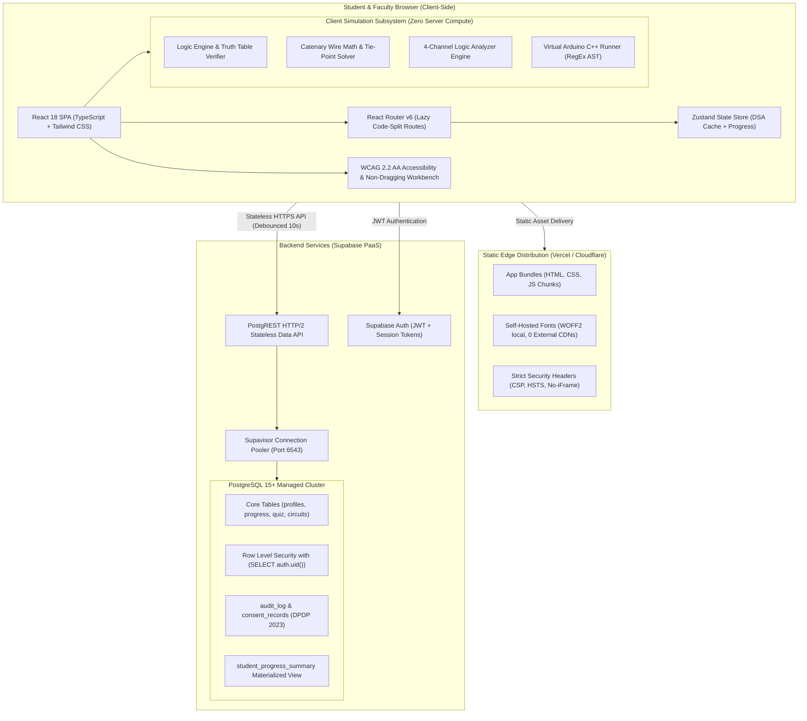

# System Architecture Specification

**Course:** Digital System Design (ECCOR2PC203) — Virtual Laboratory  
**Affiliation:** Shah & Anchor Kutchhi Engineering College (SAKEC) / Mumbai University  
**Document Version:** `v1.0.0`  
**Effective Date:** November 14, 2025 / October 2026 Audit  

---

## 1. High-Level Architectural Diagram

---

## 2. Core Architectural Principles

### 2.1 Zero-Server-Compute Simulation Engine
Unlike traditional SPICE simulators that require heavy back-end computational clusters, the Virtual DSD Lab executes **100% of its circuit simulations in the browser**:
1. **Gate Logic & Propagation:** Evaluated via optimized bitwise truth table algorithms in pure TypeScript (`utils/circuitEngine.ts`).
2. **Catenary Wire Solver:** Computes natural cable sag curves ($y = a \cdot \cosh(x / a)$) in HTML5 Canvas and SVG without server roundtrips (`utils/catenary.ts`).
3. **Logic Analyzer Oscilloscope:** 4-channel real-time signal generator using high-resolution `requestAnimationFrame` loops (`Station4LogicAnalyzer/LogicAnalyzerScope.tsx`).
4. **Microcontroller Simulation:** The Arduino sketch runner parses C++ `pinMode()`, `digitalWrite()`, `delay()`, and `Serial.print()` in an isolated Web Worker AST (`utils/sketchRunner.ts`).

### 2.2 Client State & Routing Architecture
- **Route Code Splitting:** Heavy workbench stations (`BreadboardLabPage`, `SimulatorsPage`, `LogicAnalyzerScope`, `FacultyDashboardPage`, `AdminSystemDatabasePage`) are asynchronously loaded via `React.lazy()` and `<Suspense>`. The initial landing page bundle is under **145 KB**.
- **State Hydration:** User preferences, high-contrast mode, and active lab progress hydrate from localStorage into a unified Zustand store (`store/useCourseStore.ts`).

### 2.3 Legal & Security Architecture (India DPDP Act 2023)
- **Zero Third-Party Trackers:** No Google Analytics, no Meta Pixel, no tracking cookies.
- **Self-Hosted Assets:** 14 font files (*Plus Jakarta Sans*, *Bricolage Grotesque*, *JetBrains Mono*) are hosted locally in `public/fonts/`.
- **Audit-Logged Administrative Access:** Any faculty or administrator viewing unmasked student data triggers an immutable audit log entry in `public.audit_log`.
- **Right to Erasure & Portability:** Built-in self-service `/my-data` page allows students to export their JSON data package or execute cascading account erasure.
