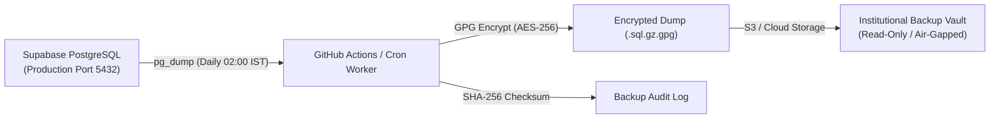

# Database Backup & Disaster Recovery Guide

**Course:** Digital System Design (ECCOR2PC203) — Virtual Laboratory  
**Applicability:** Production & Staging PostgreSQL Databases (Supabase)  
**Document Version:** `v1.0.0`  
**Effective Date:** November 14, 2025  

---

## 1. Objectives & Recovery Targets

To protect student academic assessment data, laboratory submissions, and attendance logs, the laboratory platform establishes the following recovery metrics:

| Metric | Target | Rationale |
| :--- | :--- | :--- |
| **Recovery Point Objective (RPO)** | **< 24 Hours** (Free Tier)<br>**< 2 Minutes** (Pro Tier with PITR) | Maximum acceptable data loss window in the event of hardware or cluster disaster. |
| **Recovery Time Objective (RTO)** | **< 30 Minutes** | Time required to provision a replacement instance, load the latest snapshot, and verify schema integrity. |
| **Backup Retention** | **30 Daily + 12 Monthly Snapshots** | Meets University academic audit requirements for internal term assessment records. |
| **Encryption Standard** | **AES-256 (GPG / OpenSSL)** | All offsite backup archives are encrypted before transfer to secure cloud storage. |

---

## 2. Automated Logical Backup Architecture



### 2.1 Daily Scheduled Backup Script (`backup.sh`)

```bash
#!/usr/bin/env bash
set -euo pipefail

# Configuration
TIMESTAMP=$(date +"%Y%m%d_%H%M%S")
BACKUP_DIR="/var/backups/dsd-lab"
DUMP_FILE="${BACKUP_DIR}/dsd_prod_${TIMESTAMP}.sql.gz"
ENCRYPTED_FILE="${DUMP_FILE}.gpg"

mkdir -p "${BACKUP_DIR}"

echo "[$(date)] Starting logical database dump..."
pg_dump "${SUPABASE_DB_URL}" \
  --format=plain \
  --no-owner \
  --no-privileges \
  --exclude-table-data='public.audit_log' \
  | gzip -9 > "${DUMP_FILE}"

echo "[$(date)] Generating SHA-256 checksum..."
sha256sum "${DUMP_FILE}" > "${DUMP_FILE}.sha256"

echo "[$(date)] Encrypting backup with GPG AES-256..."
gpg --symmetric --cipher-algo AES256 --batch --passphrase "${BACKUP_ENCRYPTION_KEY}" -o "${ENCRYPTED_FILE}" "${DUMP_FILE}"
rm -f "${DUMP_FILE}"

echo "[$(date)] Backup completed successfully: ${ENCRYPTED_FILE}"
```

---

## 3. Step-by-Step Disaster Recovery Drill

### Step 1: Obtain the Latest Verified Snapshot
Download the target `.sql.gz.gpg` and `.sha256` files from the institutional backup vault:

```bash
# Decrypt archive
gpg --decrypt --batch --passphrase "${BACKUP_ENCRYPTION_KEY}" \
  -o dsd_prod_restore.sql.gz dsd_prod_20261013_020000.sql.gz.gpg

# Verify checksum
sha256sum dsd_prod_restore.sql.gz
```

### Step 2: Provision or Prepare Target Database
Connect to the clean recovery database instance (e.g., Supabase Staging or fresh local Docker instance):

```bash
# Ensure target database is reachable
psql "${TARGET_DATABASE_URL}" -c "SELECT version();"
```

### Step 3: Execute Restoration
Stream the uncompressed SQL stream into the target database:

```bash
gunzip -c dsd_prod_restore.sql.gz | psql "${TARGET_DATABASE_URL}" --single-transaction
```

### Step 4: Re-apply Row Level Security & Refresh Materialized Views
Run validation queries to confirm all security boundaries and summary views are functioning:

```sql
-- Refresh continuous assessment materialized view
REFRESH MATERIALIZED VIEW CONCURRENTLY public.student_progress_summary;

-- Verify table row counts
SELECT 'profiles' AS table_name, count(*) FROM public.profiles
UNION ALL
SELECT 'progress', count(*) FROM public.progress
UNION ALL
SELECT 'quiz_attempts', count(*) FROM public.quiz_attempts
UNION ALL
SELECT 'saved_circuits', count(*) FROM public.saved_circuits;
```

### Step 5: Test Application Health
Point the staging web deployment to the restored database URL and verify:
1. Student login succeeds with existing credentials.
2. Saved breadboard circuits load onto the canvas with complete wire continuity.
3. Faculty dashboard renders student grades and completed lab counters accurately.

---

## 4. Quarterly Drill Schedule

The laboratory system administrator and faculty coordinator conduct simulated recovery drills every 90 days. Records of each recovery drill are signed and stored in the departmental academic logbook.
