# Complete PostgreSQL Database & Architecture Specification

**Course:** Digital System Design (ECCOR2PC203) — Virtual Laboratory  
**Engine:** PostgreSQL 15+ (Hosted on Supabase with Supavisor Connection Pooling)  
**Document Version:** `v1.0.0`  
**Effective Date:** November 14, 2025 / October 2026 Audit  

---

## 1. Entity-Relationship (ER) Diagram

```mermaid
erDiagram
    PROFILES ||--o{ PROGRESS : "tracks"
    PROFILES ||--o{ QUIZ_ATTEMPTS : "records"
    PROFILES ||--o{ SAVED_CIRCUITS : "owns"
    PROFILES ||--o{ CHAT_HISTORY : "participates"
    PROFILES ||--o{ CHAT_USAGE : "rate_limits"
    PROFILES ||--o{ CONSENT_RECORDS : "authorizes"
    PROFILES ||--o{ AUDIT_LOG : "triggers"

    PROFILES {
        uuid id PK "Matches auth.users(id)"
        text display_name "Full name and roll number"
        text role "student | faculty | admin"
        boolean is_active "Account status"
        text institution "College legal name"
        text department "Branch of engineering"
        timestamptz created_at
        timestamptz updated_at
    }

    PROGRESS {
        uuid id PK
        uuid user_id FK "References profiles(id)"
        text topic_id "e.g. lab-1, mod-2-sequential"
        boolean completed "Completion status"
        jsonb progress_data "Verification details"
        timestamptz updated_at
    }

    QUIZ_ATTEMPTS {
        uuid id PK
        uuid user_id FK "References profiles(id)"
        text quiz_id "Module assessment identifier"
        integer score "Obtained score"
        integer total "Total possible score"
        jsonb bloom_breakdown "Bloom taxonomy levels"
        timestamptz taken_at
    }

    SAVED_CIRCUITS {
        uuid id PK
        uuid user_id FK "References profiles(id)"
        text name "Circuit project title"
        text description "Optional description"
        jsonb circuit_json "Components and catenary wires"
        text thumbnail "Preview vector"
        timestamptz created_at
        timestamptz updated_at
    }

    CONSENT_RECORDS {
        uuid id PK
        uuid user_id FK "References profiles(id)"
        text consent_type "general_privacy | tutor_chat | age_verif"
        boolean consented "Consent state"
        timestamptz consented_at
        text policy_version "e.g. v1.0.0"
        text ip_hash "SHA-256 masked IP"
        text user_agent_hash "Client signature"
    }

    AUDIT_LOG {
        uuid id PK
        uuid actor_id FK "References profiles(id)"
        text action "UNMASK | ROLE_CHANGE | EXPORT"
        text target_entity "Target table or user"
        text target_id "Identifier of target"
        jsonb details "Context metadata"
        text ip_hash "Actor hashed IP"
        timestamptz created_at
    }

    CHAT_HISTORY {
        uuid id PK
        uuid user_id FK "References profiles(id)"
        text conversation_id "Session identifier"
        text role "user | assistant | system"
        text content "Conversation turn"
        text topic_context "Circuit or lab context"
        timestamptz created_at
    }

    CHAT_USAGE {
        uuid id PK
        uuid user_id FK "References profiles(id)"
        text client_identifier "Fallback hash"
        integer message_count "Hourly quota tracker"
        timestamptz window_start
        timestamptz updated_at
    }
```



---

## 2. Comprehensive Data Dictionary

### 2.1 Table: `profiles`
Stores student, faculty, and administrative user identity linked directly to Supabase Auth (`auth.users`).

| Column | Type | Constraints | Description |
| :--- | :--- | :--- | :--- |
| `id` | `UUID` | `PRIMARY KEY`, `REFERENCES auth.users(id) ON DELETE CASCADE` | Unique user UUID assigned during authentication signup. |
| `display_name` | `TEXT` | `NULLABLE` | Student or Faculty full name and academic roll number. |
| `avatar_url` | `TEXT` | `NULLABLE` | Optional profile image URL. |
| `role` | `TEXT` | `NOT NULL`, `CHECK (role IN ('student', 'faculty', 'admin'))`, `DEFAULT 'student'` | Role-based authorization tier. |
| `is_active` | `BOOLEAN` | `NOT NULL`, `DEFAULT TRUE` | Allows administrative suspension of accounts. |
| `institution` | `TEXT` | `DEFAULT 'Shah & Anchor Kutchhi Engineering College'` | Academic college affiliation. |
| `department` | `TEXT` | `DEFAULT 'Electronics & Computer Science'` | Engineering department branch. |
| `created_at` | `TIMESTAMPTZ` | `NOT NULL`, `DEFAULT now()` | Account creation timestamp in UTC. |
| `updated_at` | `TIMESTAMPTZ` | `NOT NULL`, `DEFAULT now()` | Last update timestamp. |

### 2.2 Table: `progress`
Records student completion of the 12 curriculum laboratory practicals and 6 theory chapters.

| Column | Type | Constraints | Description |
| :--- | :--- | :--- | :--- |
| `id` | `UUID` | `PRIMARY KEY`, `DEFAULT gen_random_uuid()` | Unique record identifier. |
| `user_id` | `UUID` | `NOT NULL`, `REFERENCES auth.users(id) ON DELETE CASCADE` | Associated student user ID. |
| `topic_id` | `TEXT` | `NOT NULL` | Module or experiment key (e.g., `lab-1`, `lab-2`, `module-3`). |
| `completed` | `BOOLEAN` | `NOT NULL`, `DEFAULT TRUE` | Whether the lab experiment or module was completed. |
| `progress_data`| `JSONB` | `DEFAULT '{}'` | Additional observation table readings or verification flags. |
| `updated_at` | `TIMESTAMPTZ` | `NOT NULL`, `DEFAULT now()` | Timestamp of completion or last modification. |
| *Constraint* | `UNIQUE` | `(user_id, topic_id)` | Prevents duplicate progress entries per user and topic. |

### 2.3 Table: `quiz_attempts`
Maintains the audit log of quiz submissions, scores, and Bloom's Taxonomy cognitive level performance.

| Column | Type | Constraints | Description |
| :--- | :--- | :--- | :--- |
| `id` | `UUID` | `PRIMARY KEY`, `DEFAULT gen_random_uuid()` | Unique attempt identifier. |
| `user_id` | `UUID` | `NOT NULL`, `REFERENCES auth.users(id) ON DELETE CASCADE` | Student taking the quiz. |
| `quiz_id` | `TEXT` | `NOT NULL` | Syllabus chapter quiz identifier. |
| `score` | `INTEGER` | `NOT NULL`, `CHECK (score >= 0)` | Student's obtained score. |
| `total` | `INTEGER` | `NOT NULL`, `CHECK (total > 0)` | Maximum achievable score. |
| `bloom_breakdown` | `JSONB` | `DEFAULT '{}'` | Scores segmented into Remembering, Understanding, Applying. |
| `taken_at` | `TIMESTAMPTZ` | `NOT NULL`, `DEFAULT now()` | UTC submission timestamp. |

### 2.4 Table: `saved_circuits`
Saves virtual solderless breadboard wirings, IC mounting coordinates, and Arduino sketch source code.

| Column | Type | Constraints | Description |
| :--- | :--- | :--- | :--- |
| `id` | `UUID` | `PRIMARY KEY`, `DEFAULT gen_random_uuid()` | Unique saved circuit identifier. |
| `user_id` | `UUID` | `NOT NULL`, `REFERENCES auth.users(id) ON DELETE CASCADE` | Author student user ID. |
| `name` | `TEXT` | `NOT NULL` | User-defined project title. |
| `description` | `TEXT` | `NULLABLE` | Optional circuit notes or syllabus experiment references. |
| `circuit_json` | `JSONB` | `NOT NULL` | Serialized array of components, DIP IC coordinates, and catenary wires. |
| `thumbnail` | `TEXT` | `NULLABLE` | Base64 or SVG preview string. |
| `created_at` | `TIMESTAMPTZ` | `NOT NULL`, `DEFAULT now()` | Initial creation date. |
| `updated_at` | `TIMESTAMPTZ` | `NOT NULL`, `DEFAULT now()` | Last autosave timestamp. |

### 2.5 Table: `consent_records`
Audit-proof log of user consent granted under the India Digital Personal Data Protection Act 2023.

| Column | Type | Constraints | Description |
| :--- | :--- | :--- | :--- |
| `id` | `UUID` | `PRIMARY KEY`, `DEFAULT gen_random_uuid()` | Unique consent entry identifier. |
| `user_id` | `UUID` | `REFERENCES auth.users(id) ON DELETE CASCADE` | Student or Faculty user ID. |
| `consent_type` | `TEXT` | `NOT NULL`, `CHECK (consent_type IN ('general_privacy', 'tutor_chat_storage', 'age_verification', 'data_export'))` | Purpose category for which consent was granted. |
| `consented` | `BOOLEAN` | `NOT NULL`, `DEFAULT TRUE` | Whether consent is currently active or withdrawn. |
| `consented_at`| `TIMESTAMPTZ` | `NOT NULL`, `DEFAULT now()` | Timestamp when checkbox was checked. |
| `policy_version`| `TEXT` | `NOT NULL`, `DEFAULT 'v1.0.0'` | Semantic policy version active when user consented. |
| `ip_hash` | `TEXT` | `NULLABLE` | One-way SHA-256 hash of student IP for audit logging. |
| `user_agent_hash`| `TEXT`| `NULLABLE` | One-way SHA-256 hash of browser User-Agent header. |

### 2.6 Table: `audit_log`
Tamper-evident administrative audit log tracking data access, unmask actions, and role changes.

| Column | Type | Constraints | Description |
| :--- | :--- | :--- | :--- |
| `id` | `UUID` | `PRIMARY KEY`, `DEFAULT gen_random_uuid()` | Unique audit event identifier. |
| `actor_id` | `UUID` | `REFERENCES auth.users(id) ON DELETE SET NULL` | Administrator or faculty executing the action. |
| `action` | `TEXT` | `NOT NULL` | Action code (e.g. `UNMASK_DATA`, `EXPORT_DATA`, `ROLE_CHANGE`). |
| `target_entity`| `TEXT` | `NOT NULL` | Target table or entity operated upon. |
| `target_id` | `TEXT` | `NULLABLE` | ID of the specific record inspected or altered. |
| `details` | `JSONB` | `DEFAULT '{}'` | Additional diagnostic metadata. |
| `ip_hash` | `TEXT` | `NULLABLE` | Masked IP hash of the actor. |
| `created_at` | `TIMESTAMPTZ` | `NOT NULL`, `DEFAULT now()` | Exact timestamp of administrative event. |

---

## 3. High-Performance Indexing Strategy

To guarantee sub-50ms query latency under 1,000+ student concurrency, composite indexes are established:

```sql
-- Composite index for student progress queries
CREATE INDEX idx_progress_user_topic ON public.progress(user_id, topic_id);

-- Composite index for debounced circuit autosaves ordered by recency
CREATE INDEX idx_saved_circuits_user_updated ON public.saved_circuits(user_id, updated_at DESC);

-- Composite index for quiz attempts history
CREATE INDEX idx_quiz_attempts_user_taken ON public.quiz_attempts(user_id, taken_at DESC);

-- Consent verification index
CREATE INDEX idx_consent_records_user_type ON public.consent_records(user_id, consent_type);

-- Audit log chronological index
CREATE INDEX idx_audit_log_actor_created ON public.audit_log(actor_id, created_at DESC);

-- Profile role lookup index
CREATE INDEX idx_profiles_role_active ON public.profiles(role, is_active);
```

---

## 4. Continuous Assessment Materialized View

For instantaneous faculty reports without running N+1 sequential table joins, the `student_progress_summary` materialized view aggregates data concurrently:

```sql
CREATE MATERIALIZED VIEW public.student_progress_summary AS
SELECT
  p.id AS student_id,
  p.display_name,
  p.institution,
  p.department,
  COUNT(DISTINCT pr.id) FILTER (WHERE pr.completed = TRUE AND pr.topic_id LIKE 'lab-%') AS completed_labs_count,
  COUNT(DISTINCT qa.id) AS total_quizzes_taken,
  COALESCE(ROUND(AVG(qa.score)::numeric, 1), 0.0) AS average_quiz_score,
  COUNT(DISTINCT sc.id) AS saved_circuits_count,
  GREATEST(MAX(pr.updated_at), MAX(qa.taken_at), MAX(sc.updated_at), p.updated_at) AS last_active_at
FROM public.profiles p
LEFT JOIN public.progress pr ON pr.user_id = p.id
LEFT JOIN public.quiz_attempts qa ON qa.user_id = p.id
LEFT JOIN public.saved_circuits sc ON sc.user_id = p.id
WHERE p.role = 'student'
GROUP BY p.id, p.display_name, p.institution, p.department, p.updated_at;

-- Unique index allows non-blocking concurrent refresh:
CREATE UNIQUE INDEX idx_student_progress_summary_id ON public.student_progress_summary(student_id);
```
