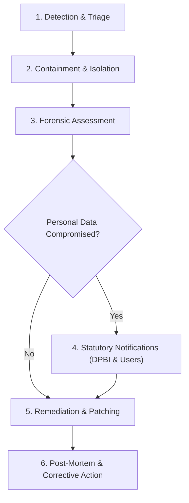

# Personal Data Incident & Breach Response Runbook
**Course Platform: Digital System Design Virtual Lab (ECCOR2PC203)**  
**Fiduciary Entity:** [COLLEGE LEGAL NAME]  
**Version:** 1.0.0  
**Effective Date:** November 14, 2025  

---

## 1. Overview & Purpose
This runbook establishes standard operating procedures for detecting, containing, investigating, and reporting any personal data breach or cybersecurity incident affecting the Virtual DSD Lab portal. It operationalizes statutory requirements under **Section 8(6) of India's Digital Personal Data Protection Act, 2023 (DPDP Act)**, the **DPDP Rules, 2025**, and the **CERT-In Cyber Security Directions (2022)**.

---

## 2. Severity Classification

| Tier | Severity | Description | Response SLA |
| :--- | :--- | :--- | :--- |
| **P1** | **Critical Breach** | Compromise of production database credentials, unauthorized exfiltration of student records or auth tokens, or systemic Row Level Security (RLS) bypass. | **Immediate (Under 1 hour)** |
| **P2** | **High** | Compromise of an individual faculty or student account without systemic privilege escalation; brute-force credential stuffing attempt. | **Under 4 hours** |
| **P3** | **Medium** | Isolated failure of audit logging, improper rate-limiting on support form, or localized transient error exposing non-sensitive metadata. | **Under 12 hours** |
| **P4** | **Low** | Non-PII telemetry anomaly, benign vulnerability scan detection, or user-reported false positive. | **Within 2 business days** |

---

## 3. Incident Response Lifecycle



### Phase 1: Detection & Triage (Hour 0)
1. **Identification Sources:** Alert triggered by automated database anomaly monitor, Edge Function error spike, user grievance notification, or cloud hosting alert.
2. **First Responder Actions:**
   - Immediately notify the Incident Response Lead, Course Coordinator, and Grievance Redressal Officer:
     - Lead: Course Coordinator ([CONTACT EMAIL])
     - Legal / Compliance: Grievance Officer ([GRIEVANCE OFFICER EMAIL])
     - Infrastructure: Department IT Administrator
   - Freeze all deployment pipelines and log active database sessions.

### Phase 2: Containment & Isolation (Hours 1–2)
1. **Revoke and Rotate Compromised Credentials:**
   - If Supabase anon key or Edge Function secrets are exposed, immediately rotate them via Supabase CLI:
     ```bash
     supabase secrets set ANTHROPIC_API_KEY=sk-ant-new...
     supabase secrets set SUPABASE_SERVICE_ROLE_KEY=new...
     ```
   - Invalidate active JWT sessions by terminating all user sessions via Supabase Auth Admin API.
2. **Network Isolation:**
   - If an ongoing exfiltration attempt is active, temporarily enable maintenance mode on the CDN host (Cloudflare / Vercel) to restrict public ingress.
   - Enforce IP whitelisting on database direct connections.

### Phase 3: Forensic Assessment (Hours 2–6)
1. Determine the exact scope of personal data accessed or exfiltrated:
   - Run audit query on `public.audit_log` and PostgreSQL connection logs:
     ```sql
     SELECT * FROM public.audit_log 
     WHERE created_at >= NOW() - INTERVAL '24 hours' 
     ORDER BY created_at DESC;
     ```
2. Verify whether affected records contain sensitive data (passwords, emails, quiz grades, circuits).
3. Evaluate the likelihood and severity of harm to affected students and educators.

### Phase 4: Statutory Notifications (Hours 6–72)
1. **Notification to the Data Protection Board of India (DPBI):**
   - In accordance with Section 8(6) of the DPDP Act and DPDP Rules 2025, notify the DPBI through its designated reporting portal without undue delay.
   - The intimation must contain:
     - Description of the nature and circumstances of the personal data breach.
     - Approximate number of data principals (students/faculty) impacted.
     - Likely consequences and risks of harm.
     - Mitigation and containment steps already implemented and proposed.
     - Contact details of the Grievance Officer.
2. **Notification to Affected Data Principals (Students & Faculty):**
   - Transmit an official email notification directly to affected students via the registered college email domain.
   - Include plain-language instructions:
     - Clear explanation of what occurred.
     - Actions students should take (e.g. reset passwords, monitor for phishing).
     - Link to the Grievance Officer portal.
3. **Notification to CERT-In:**
   - In case of a major cybersecurity incident (e.g. ransomware, unauthorized server intrusion), submit intimation to `incident@cert-in.org.in` within statutory timelines.

### Phase 5: Remediation & Verification
1. Apply targeted software patch or database RLS policy modification.
2. Verify automated regression tests (`npm test`) and security checks (`npm run build`).
3. Restore clean backup if data corruption occurred, following `docs/BACKUP_RESTORE.md`.

### Phase 6: Post-Mortem & Corrective Action (Within 5 Days)
1. Convene incident debrief with Institutional Academic IT Committee.
2. Produce a formal Incident Investigation Report detailing root cause, timeline, affected rows, and preventative measures.
3. Archive post-mortem records for a minimum of 3 years.
